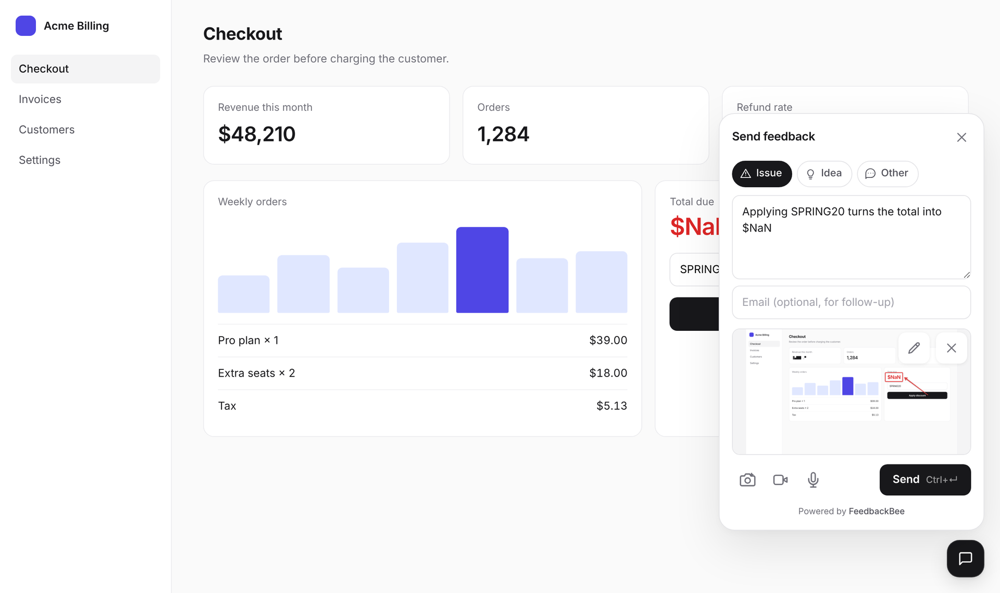
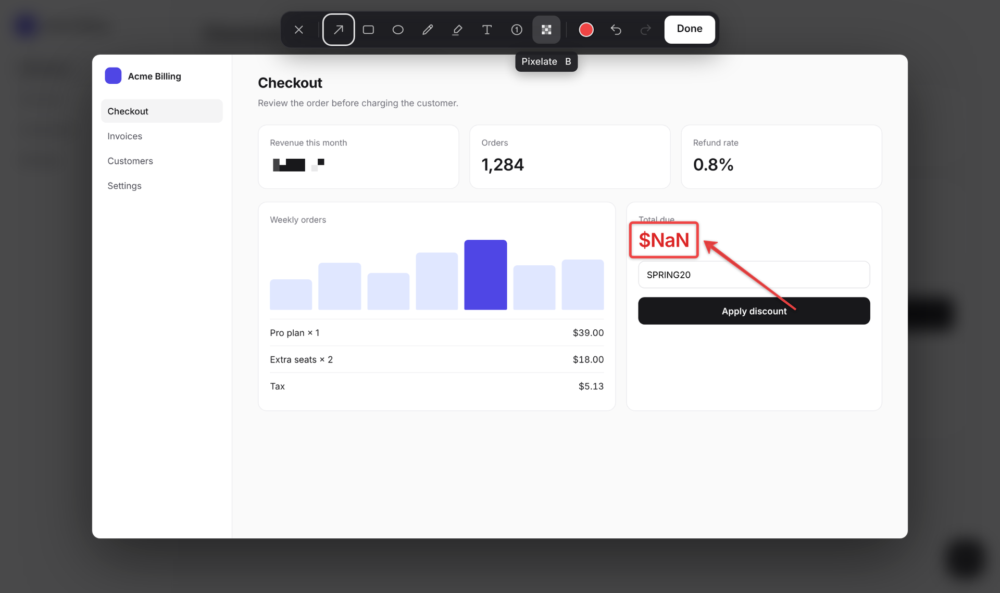
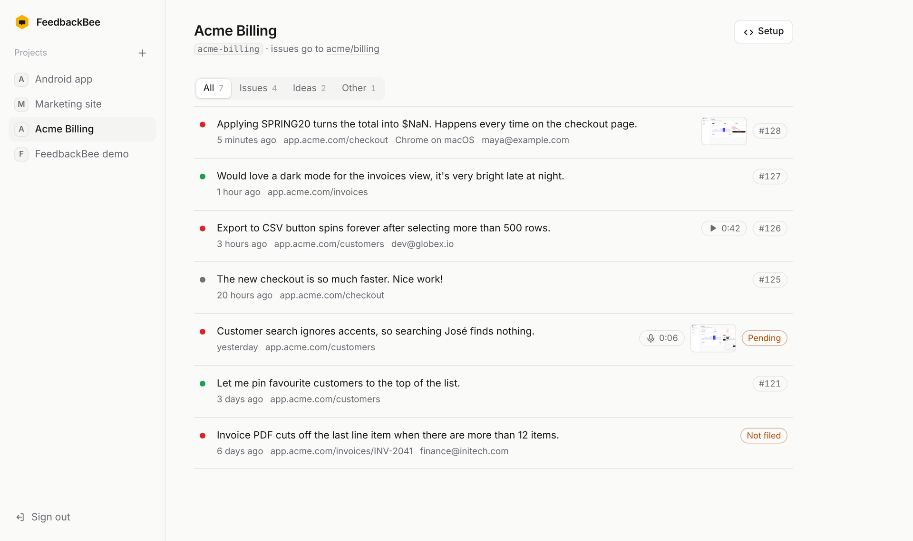
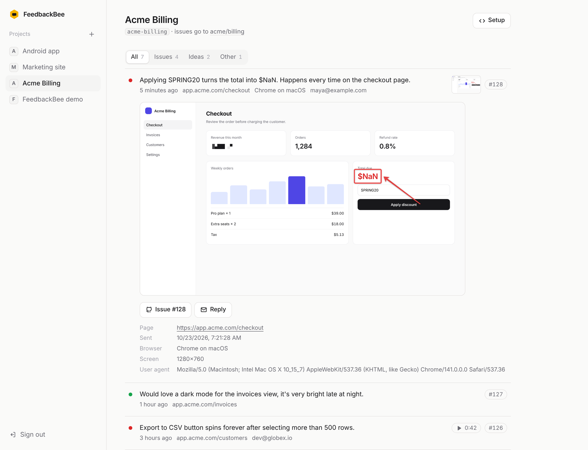

# FeedbackBee

Lightweight, self-hostable user feedback on the Cloudflare free tier. Visitors click a widget in your app, annotate a screenshot or record the screen, and the feedback lands as a labeled GitHub issue.

### Widget

A single panel: pick a type, write a note, attach a screenshot, page recording or voice note, send. Screenshots capture the current page with no screen-share prompt, then open in a CleanShot-style editor (arrow, box, highlighter, text, step numbers, pixelate).

<p>
  
  
</p>

### Dashboard

One inbox per project, filtered by type. Rows expand to the screenshot, session replay or voice note, the GitHub issue, and the reporter's device context.

<p>
  
  
</p>

[](https://deploy.workers.cloudflare.com/?url=https://github.com/AshikNesin/feedbackbee)

One click provisions D1 + R2, builds, and deploys; migrations apply on the first request. Open the deployed URL and the first sign-in creates your owner account. Then set one secret: `pnpm exec wrangler secret put GITHUB_TOKEN` (fine-grained PAT, Issues: Read and Write).

- **PRD**: [docs/PRD.md](docs/PRD.md)
- **Upload contract**: [docs/CONTRACT.md](docs/CONTRACT.md)
- **Deploy runbook**: [docs/DEPLOY.md](docs/DEPLOY.md)
- **Android SDK**: `android/` (Kotlin, `FeedbackBee.init(app, projectId, endpoint)`, shake-to-feedback)
- **Boilerplate**: built on [groot](https://github.com/AshikNesin/groot) (Hono + React + Drizzle); its guides start at [docs/README.md](docs/README.md)

## Embed in any web app

```html
<script src="https://your-bee.workers.dev/embed.js" data-project="myapp" async></script>
```

## Android

```kotlin
FeedbackBee.init(this, projectId = "myapp", endpoint = "https://your-bee.workers.dev")
FeedbackBee.open() // or your own button
```

The Android `endpoint` is required: use your FeedbackBee website or Worker base URL. There is no default server.

## Local dev

```bash
pnpm install
pnpm dev           # Node + Vite HMR; sign in with demo@example.com / demo@example.com
pnpm dev:worker    # the real Worker in workerd (local D1 + R2) at http://localhost:8787
pnpm test:worker   # FeedbackBee's integration suite, in workerd
pnpm test          # groot's server suites
```

Set `GITHUB_TOKEN` in `.env` (for `pnpm dev`) or `.dev.vars` (for `pnpm dev:worker`) to file real issues. `GET /demo` hosts a demo page with the widget; the `demo` project is provisioned on first visit.

## Inspiration

- Feedback.fish
