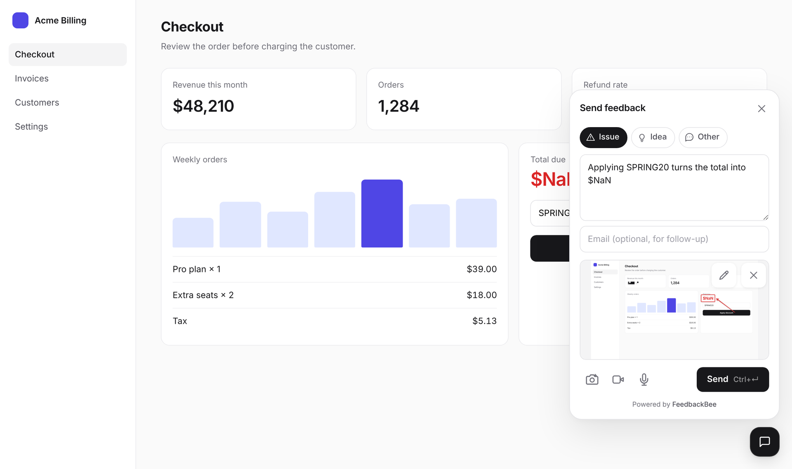
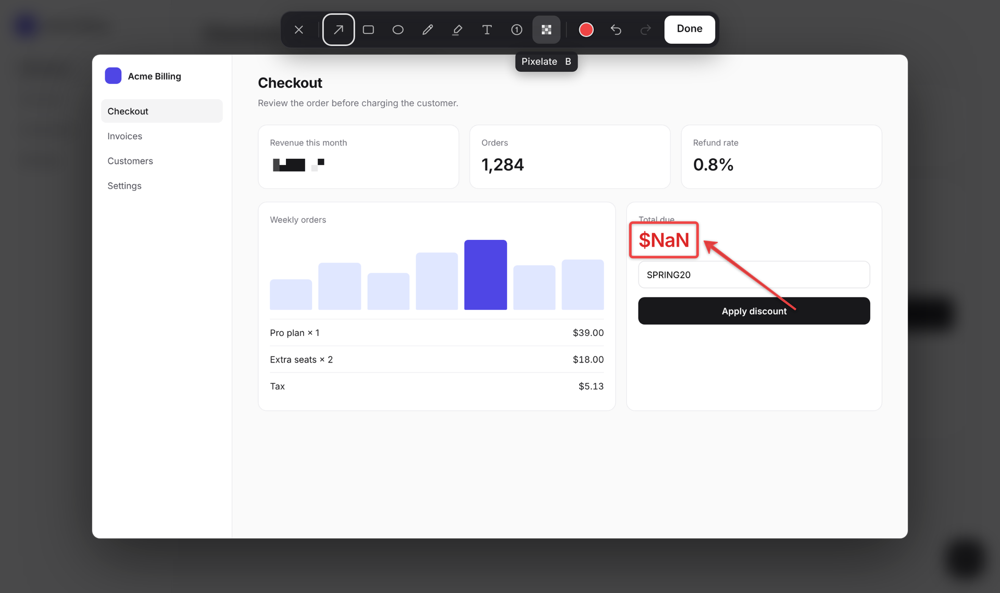
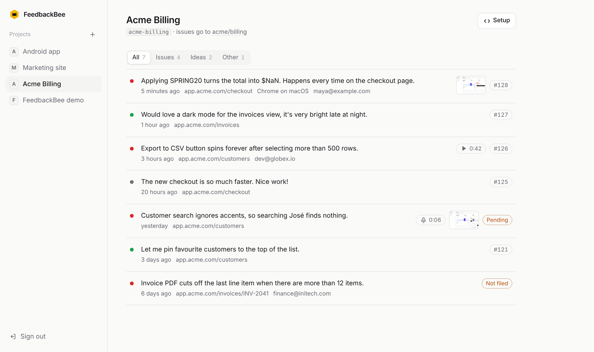
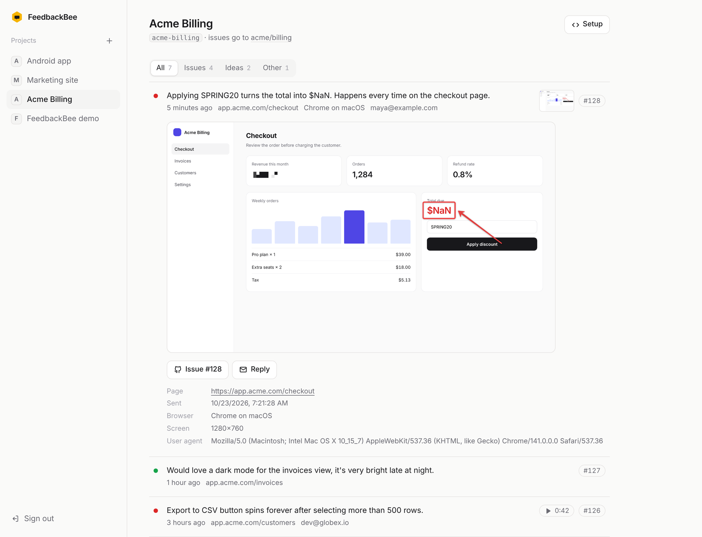

# FeedbackBee

Lightweight, self-hostable user feedback on the Cloudflare free tier. Visitors click a widget in your app, annotate a screenshot or record the screen, and the feedback lands as a labeled GitHub issue.

### Widget

A single panel: pick a type, write a note, attach a screenshot, page recording or voice note, send. Screenshots capture the current page with no screen-share prompt, then open in a CleanShot-style editor (arrow, box, highlighter, text, step numbers, pixelate).

<p>
  
  
</p>

### Dashboard

One inbox per project, filtered by type. Rows expand to the screenshot, session replay or voice note, the GitHub issue, and the reporter's device context.

<p>
  
  
</p>

[](https://deploy.workers.cloudflare.com/?url=https://github.com/AshikNesin/feedbackbee)

One click provisions D1 + R2, builds, and deploys; migrations apply on the first request. Before connecting GitHub, set the required encryption secret with `openssl rand -base64 32 | pnpm exec wrangler secret put FEEDBACKBEE_ENCRYPTION_KEY`. Keep this Worker secret outside D1 and its backups; do not change or lose it. Open `/app` on the deployed URL and the first sign-in creates your owner account (the website from `site/` is served at `/`). In **Settings → GitHub**, register a private GitHub App from the manifest, choose a personal or organization owner, then install it on the repositories you want to use. FeedbackBee does not accept manually pasted GitHub credentials.

## Documentation

| Topic           | Doc                                              | Covers                                                                                                   |
| --------------- | ------------------------------------------------ | -------------------------------------------------------------------------------------------------------- |
| Web widget      | [docs/WIDGET.md](docs/WIDGET.md)                 | Script tag and `data-*` options, JavaScript API, button hooks, light/dark theme, troubleshooting         |
| Android SDK     | [android/README.md](android/README.md)           | Kotlin setup, API, shake, permissions, light/dark mode, demo app                                         |
| iOS + macOS SDK | [apple/README.md](apple/README.md)               | Swift package setup, API, shake (iOS), Help menu (macOS), entitlements, light/dark mode, troubleshooting |
| React Native    | [react-native/README.md](react-native/README.md) | Install, API, light/dark mode, permissions, troubleshooting                                              |
| Upload contract | [docs/CONTRACT.md](docs/CONTRACT.md)             | `POST /api/v1/feedback` fields, responses, limits, privacy (what reaches GitHub)                         |
| Deploy          | [docs/DEPLOY.md](docs/DEPLOY.md)                 | Cloudflare deploy, secrets, GitHub App, operations                                                       |
| Product         | [docs/PRD.md](docs/PRD.md)                       | Goals, scope, milestones                                                                                 |
| Website         | [site/README.md](site/README.md)                 | How the marketing site is built                                                                          |
| Boilerplate     | [docs/README.md](docs/README.md)                 | Built on [groot](https://github.com/AshikNesin/groot) (Hono + React + Drizzle): architecture, testing    |

Every client (web, Android, iOS, macOS, React Native) shows the same three screens and uses the same light and dark
palette, posting to the same endpoint.

## Embed in any web app

```html
<script src="https://your-bee.workers.dev/embed.js" data-project="myapp" async></script>
```

## Android

```kotlin
FeedbackBee.init(this, projectId = "myapp", endpoint = "https://your-bee.workers.dev")
FeedbackBee.open() // or your own button
```

The Android `endpoint` is required: use your FeedbackBee website or Worker base URL. There is no default server.

## iOS and macOS

```swift
try FeedbackBee.configure(projectId: "myapp", endpoint: "https://your-bee.workers.dev")
FeedbackBee.open() // or your own button
```

On iOS a shake opens it too; on macOS add `FeedbackBee.menuItem()` to the Help menu. See [apple/README.md](apple/README.md).

## React Native

```ts
import FeedbackBee from "react-native-feedbackbee";

FeedbackBee.init({ projectId: "myapp", endpoint: "https://your-bee.workers.dev" });
FeedbackBee.open(); // or your own button
```

The sheet, capture and upload are the native iOS and Android SDKs; see [react-native/README.md](react-native/README.md).

## Local dev

```bash
pnpm install
pnpm dev           # Node + Vite HMR; sign in with demo@example.com / demo@example.com
pnpm dev:worker    # the real Worker in workerd (local D1 + R2) at http://localhost:8787
pnpm test:worker   # FeedbackBee's integration suite, in workerd
pnpm test          # groot's server suites
```

For local GitHub integration, set `FEEDBACKBEE_ENCRYPTION_KEY` in `.env` (`pnpm dev`) or `.dev.vars` (`pnpm dev:worker`) using `openssl rand -base64 32`. GitHub App registration requires a public HTTPS callback: run local development behind an HTTPS tunnel and set `ORIGIN` explicitly to that tunnel URL. `GET /demo` hosts a demo page with the widget; the `demo` project is provisioned on first visit.

## Inspiration

- Feedback.fish
