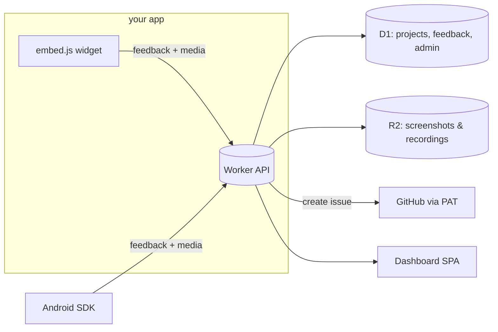

# FeedbackBarn

Lightweight, self-hostable user feedback on the Cloudflare free tier. Visitors click a widget in your app, annotate a screenshot or record the screen, and the feedback lands as a labeled GitHub issue. Think feedback.fish that you own.

- **PRD**: [docs/PRD.md](docs/PRD.md)
- **Web app + API**: Cloudflare Worker (Hono) + D1 + R2, Vite SPA dashboard
- **Android SDK**: `android/` (Kotlin, shake-to-feedback)

## Quick start

```bash
npm install
npm run dev                  # API at http://localhost:8787, dashboard at / (Vite proxy)
```

Create the D1/R2 resources once per Cloudflare account:

```bash
npx wrangler d1 create feedbackbarn       # paste database_id into wrangler.jsonc
npx wrangler r2 bucket create feedbackbarn-media
npm run deploy
```

## How it fits together


