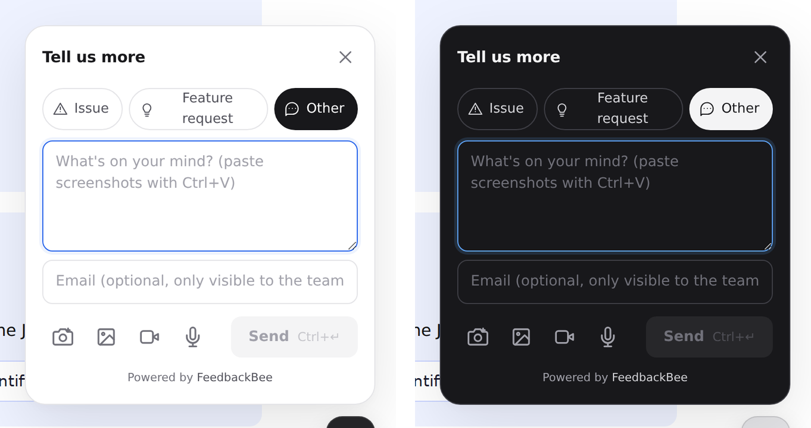
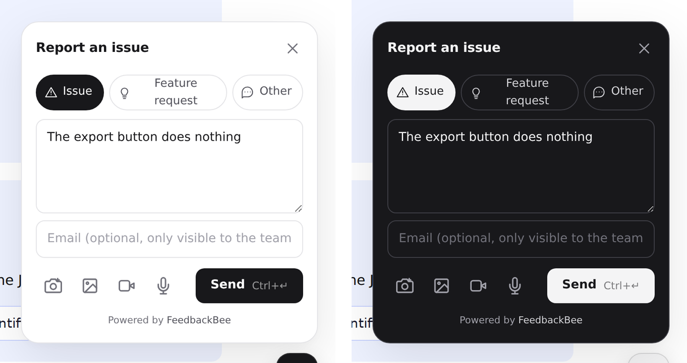

# Web widget

The widget is one script, `/embed.js`, served by your FeedbackBee deployment.
It adds a feedback pill to the page, collects text, screenshots, a screen
recording and a voice note, and posts them to `POST /api/v1/feedback` (the
[upload contract](./CONTRACT.md)). No build step and no dependencies.

Source: `apps/web/src/server/embed/widget.js`. The shipped copy in
`apps/web/src/server/generated/embed_js.ts` is generated by `pnpm build:embed`;
don't edit it.

## Install

Paste this before `</body>`. The Setup dialog in the dashboard prints it with
your project and deployment filled in.

```html
<script src="https://YOUR-DEPLOYMENT/embed.js" data-project="PROJECT_ID" async></script>
```

`async` is fine: the script exits quietly if a second copy loads, and it waits
for the DOM before it builds anything. The script URL must contain `/embed.js`
(the widget finds its own tag by that).

### Script attributes

| Attribute       | Values                            | Default                               | Effect                                                                                                       |
| --------------- | --------------------------------- | ------------------------------------- | ------------------------------------------------------------------------------------------------------------ |
| `data-project`  | project id or slug                | none                                  | The project reports go to. Without it (and without `init({ project })`) the widget does nothing visible.     |
| `data-endpoint` | origin, e.g. `https://fb.acme.io` | the origin the script was loaded from | Where `/api/v1/feedback`, `/embed-capture.js` and `/embed-record.js` are fetched from. Trailing `/` removed. |
| `data-position` | `bottom-left`; anything else      | bottom right                          | Corner of the pill, panel and recording bar.                                                                 |
| `data-headless` | present, or any value but `false` | off                                   | No pill. The panel opens as a centered modal with a dimmed backdrop, from `open()` or a button hook.         |
| `data-theme`    | `light`, `dark`, `auto`           | `light`                               | See [Light and dark mode](#light-and-dark-mode). An unknown value falls back to `light`.                     |

Attributes are read once from the script tag. `init()` can change the same
options later (see below).

## Before the script loads: the queue stub

Calls made before `/embed.js` has loaded are queued by a stub and replayed in
order when it arrives. Put this in `<head>` or before your first call:

```html
<script>
  window.FeedbackBee = window.FeedbackBee || { q: [] };
  "init ready identify setContext open close on off reset".split(" ").map(function (m) {
    window.FeedbackBee[m] = function () {
      var a = [].slice.call(arguments);
      return new Promise(function (r, j) {
        window.FeedbackBee.q.push([m, a, r, j]);
      });
    };
  });
</script>
```

Every stubbed call returns a promise, which settles with the real method's
result once the script loads. `isOpen()` and `version` are not stubbed.

If `window.FeedbackBee` already holds something that isn't this stub (no `q`
array), the widget leaves it alone, logs a warning and exposes its API as
`window.__feedbackbee` instead.

## JavaScript API

`window.FeedbackBee` (after load):

| Member                 | Returns           | Notes                                                                                                                                                                                             |
| ---------------------- | ----------------- | ------------------------------------------------------------------------------------------------------------------------------------------------------------------------------------------------- |
| `version`              | string            | Widget version, `"2.0.0"` today.                                                                                                                                                                  |
| `init(options)`        | the API object    | Merges `options` over the script attributes. Can be called more than once. See below.                                                                                                             |
| `ready()`              | `Promise<void>`   | Resolves once the DOM is ready and the widget has booted.                                                                                                                                         |
| `identify(user)`       | nothing           | `{ email, name, id }` (all optional strings). The email is prefilled and read-only in the form; `name` and `id` are sent as `reporter_name` and `reporter_id`. `identify(null)` forgets the user. |
| `setContext(metadata)` | nothing           | Merges `metadata` into the sticky metadata sent with every report. A `null` value removes that key; `setContext(null)` clears all.                                                                |
| `open(options)`        | `Promise<Result>` | Opens the panel. Resolves when it closes. See below.                                                                                                                                              |
| `close()`              | nothing           | Closes the panel (ignored while a report is being sent).                                                                                                                                          |
| `isOpen()`             | boolean           | Whether the panel is open.                                                                                                                                                                        |
| `on(event, fn)`        | `() => void`      | Subscribes; the returned function unsubscribes. A throwing listener never breaks the widget.                                                                                                      |
| `off(event, fn)`       | nothing           | Removes a listener added with `on`.                                                                                                                                                               |
| `reset()`              | nothing           | Forgets the identified user, sticky metadata and email, and closes the panel (a dismissal).                                                                                                       |

### `init(options)`

| Option     | Type    | Notes                                                                                                                |
| ---------- | ------- | -------------------------------------------------------------------------------------------------------------------- |
| `project`  | string  | Same as `data-project`.                                                                                              |
| `endpoint` | string  | Same as `data-endpoint`.                                                                                             |
| `position` | string  | `"bottom-left"` or `"left"`, or `"bottom-right"` or `"right"`.                                                       |
| `headless` | boolean | Switches the pill on or off at runtime.                                                                              |
| `theme`    | string  | `"light"`, `"dark"` or `"auto"`. Applies immediately; other values are ignored.                                      |
| `preload`  | boolean | Fetches `/embed-capture.js` when the browser is idle, so the first screenshot is instant. No attribute for this one. |

### `open(options)`

Every option is optional.

| Option        | Type    | Notes                                                                                                                                                                                                            |
| ------------- | ------- | ---------------------------------------------------------------------------------------------------------------------------------------------------------------------------------------------------------------- |
| `kind`        | string  | `"issue"`, `"feature_request"` or `"other"` (default). The old names `bug`, `idea`, `feedback` are rejected with a message naming the new one.                                                                   |
| `lockKind`    | boolean | Hides the kind picker.                                                                                                                                                                                           |
| `text`        | string  | Prefilled text.                                                                                                                                                                                                  |
| `email`       | string  | Prefilled and read-only; wins over `identify()`.                                                                                                                                                                 |
| `metadata`    | object  | Merged over `setContext` data for this report. Same rules as the contract: ≤ 20 keys, ≤ 4 KB, keys `[A-Za-z0-9_.-]{1,40}`, values string, number or boolean. Invalid entries are dropped with a console warning. |
| `url`         | string  | Sent instead of `location.href`.                                                                                                                                                                                 |
| `title`       | string  | Replaces the form title.                                                                                                                                                                                         |
| `placeholder` | string  | Replaces the note placeholder.                                                                                                                                                                                   |
| `appVersion`  | string  | Sent as `app_version` (`app_version` also works).                                                                                                                                                                |

The promise resolves with `{ status: "dismissed" }`, or, after a successful
send, `{ status: "submitted", id, kind, state }` where `state` is `created` or
`issue_error` as in the contract. It rejects with a `TypeError` if no project
is configured or `kind` is unknown. Calling `open()` while already open returns
the in-flight promise and ignores the new options.

### Events

`FeedbackBee.on(name, fn)`. Each event is also dispatched on `window` as a
`CustomEvent` named `feedbackbee:<name>` with the same `detail`.

| Event    | Detail                                       | Fires                                          |
| -------- | -------------------------------------------- | ---------------------------------------------- |
| `ready`  | `{ version }`                                | Once the widget has booted.                    |
| `open`   | `{ kind }`                                   | The panel opened.                              |
| `close`  | `{ reason }`: `"submitted"` or `"dismissed"` | The panel closed.                              |
| `kind`   | `{ kind }`                                   | The reporter picked a kind.                    |
| `submit` | `{ id, state, kind }`                        | A report was stored.                           |
| `error`  | `{ status, message }`                        | A send failed (`status` 0 for network errors). |

```js
FeedbackBee.init({ project: "PROJECT_ID", theme: "auto" });
FeedbackBee.identify({ email: "jane@acme.com", name: "Jane Doe", id: "u_123" });
FeedbackBee.setContext({ plan: "pro" });
FeedbackBee.on("submit", (e) => console.log("sent", e.id));
FeedbackBee.open({ kind: "issue", lockKind: true }).then((r) => {
  if (r.status === "submitted") console.log(r.id);
});
```

## Button hooks

Any element with `data-feedbackbee-open` opens the panel on click. The hook is
delegated on `document`, so it works for elements added later and in headless
mode.

| Attribute                    | Effect                                                     |
| ---------------------------- | ---------------------------------------------------------- |
| `data-feedbackbee-open`      | Required. Opens the panel.                                 |
| `data-feedbackbee-kind`      | `issue`, `feature_request` or `other`.                     |
| `data-feedbackbee-lock-kind` | Present (or any value but `false`): hides the kind picker. |
| `data-feedbackbee-text`      | Prefilled text.                                            |

```html
<button data-feedbackbee-open data-feedbackbee-kind="issue" data-feedbackbee-lock-kind>
  Report a bug
</button>
```

`data-tip` appears on the annotation toolbar's buttons for its tooltips. It is
internal, not a hook.

## What the reporter sees

1. **The pill** (48 px, a corner of the page) opens the panel. `Esc` closes it.
2. **Kind picker and form**: Issue, Feature request, Other, a note, an
   optional email (read-only text when the email is known), then the tools row
   and **Send** (`Ctrl/⌘+Enter`).
3. **Images**: up to 5, from paste, drag and drop, the file picker or the
   camera button. The camera button captures the page in place (lazy-loads
   `/embed-capture.js`, a vendored `modern-screenshot`); pages that block that
   offer to share the screen instead. Each shot opens in the annotation editor
   (arrow, rectangle, ellipse, pen, highlighter, text, step numbers, pixelate, colors, undo) before it is attached.
4. **Screen recording**: records the page as an rrweb DOM replay (lazy-loads
   `/embed-record.js`, a vendored `@rrweb/record`), up to 300 seconds, with
   password inputs masked and the widget itself excluded. It is sent as a
   gzipped replay and watched at `/replay/<key>`. Needs `CompressionStream`.
5. **Voice note**: microphone via `MediaRecorder`, up to 300 seconds.
6. **Sent**: "Thanks, feedback sent", closing itself after 3 seconds.

Caps are the contract's, enforced again by the server: images PNG/JPEG/WebP,
10 MB each and 50 MB combined; recording 200 MB; voice note 25 MB; 20 reports
per hour per project and IP.

## Light and dark mode

<p>
  
  
</p>

| `data-theme`      | Behaviour                                                                                    |
| ----------------- | -------------------------------------------------------------------------------------------- |
| `light` (default) | Always light. Existing embeds don't change.                                                  |
| `dark`            | Always dark.                                                                                 |
| `auto`            | Follows the OS (`prefers-color-scheme`) and switches live when it changes, without a reload. |

`init({ theme })` takes the same values. The theme styles the pill, panel,
fields, buttons (including disabled), voice-note row, thumbnails, error line,
"sent" screen and the screenshot capture card. `color-scheme` follows the
theme, so scrollbars and native controls match. The widget never reads the
host page's own theme.

The annotation toolbar and editor overlay, the recording bar and the
"Capturing" pill are dark in both modes by design.

The palette is the one the Android, iOS and macOS SDKs use:

| Token   | Light     | Dark      | Used for                                                              |
| ------- | --------- | --------- | --------------------------------------------------------------------- |
| Panel   | `#FFFFFF` | `#18181B` | Panel and field background                                            |
| Ink     | `#18181B` | `#F4F4F5` | Text, primary button fill, pill                                       |
| Muted   | `#71717A` | `#A1A1AA` | Secondary text, icons                                                 |
| Tile    | `#F4F4F5` | `#27272A` | Voice row, thumbnails, hover, disabled button                         |
| Border  | `#E4E4E7` | `#3F3F46` | Outlines                                                              |
| TileInk | `#52525B` | `#D4D4D8` | Text on tiles and unselected kind chips                               |
| Focus   | `#2563EB` | `#60A5FA` | Focus ring                                                            |
| Error   | `#DC2626` | `#F87171` | Errors (the widget's error text uses `#B91C1C` in light for contrast) |

The primary button is Ink with Panel text: white on `#18181B` in light,
`#18181B` on `#F4F4F5` in dark.

## Origins and CSP

- The widget talks to one origin, `data-endpoint` (default: where the script
  came from), for `POST /api/v1/feedback`, `/embed-capture.js` and
  `/embed-record.js`. Recordings and images are uploaded there, never to a
  third party.
- With a Content-Security-Policy, allow that origin in `script-src` and
  `connect-src`. The widget injects one `<style>` element, so `style-src`
  needs `'unsafe-inline'` or a policy that permits it. Screenshots draw to
  canvas and may use `blob:` and `data:` URLs.
- A project can restrict which websites may post to it (**Allowed origins**
  in its settings): a request whose `Origin` isn't listed gets `403` and the
  widget shows the server's message. See [CONTRACT.md](./CONTRACT.md#allowed-origins).

## Privacy

Reporters' data reaches your team, not GitHub. The issue gets the text, kind,
attachments, OS/device fields and the user agent. `email`, `reporter_name`,
`reporter_id`, `metadata` and the page `url` stay in FeedbackBee and the
dashboard ([CONTRACT.md → Privacy](./CONTRACT.md#privacy)). Nothing is sent
until the reporter presses Send; screenshots, recordings and voice notes are
attached by the reporter's own action. Passwords are masked in recordings.

## Troubleshooting

| Symptom                                         | Check                                                                                                                   |
| ----------------------------------------------- | ----------------------------------------------------------------------------------------------------------------------- |
| No pill                                         | `data-project` missing, or `data-headless` is set.                                                                      |
| `open()` rejects with a `TypeError`             | No project configured, or `kind` isn't `issue`, `feature_request` or `other`.                                           |
| "Couldn't send" with a 403                      | The page's origin isn't in the project's allowed origins.                                                               |
| 429                                             | More than 20 reports per hour from that project and IP.                                                                 |
| Screenshot fails                                | The page blocks in-page capture; use the **Share screen** fallback. Check CSP for `/embed-capture.js`.                  |
| No record button or recording fails             | The browser lacks `CompressionStream`, or `/embed-record.js` is blocked.                                                |
| Dark mode not applied                           | `data-theme` must be on the same script tag, spelled `dark` or `auto`. `FeedbackBee.init({ theme: "dark" })` works too. |
| `window.__feedbackbee` instead of `FeedbackBee` | Something else already owns `window.FeedbackBee`.                                                                       |
