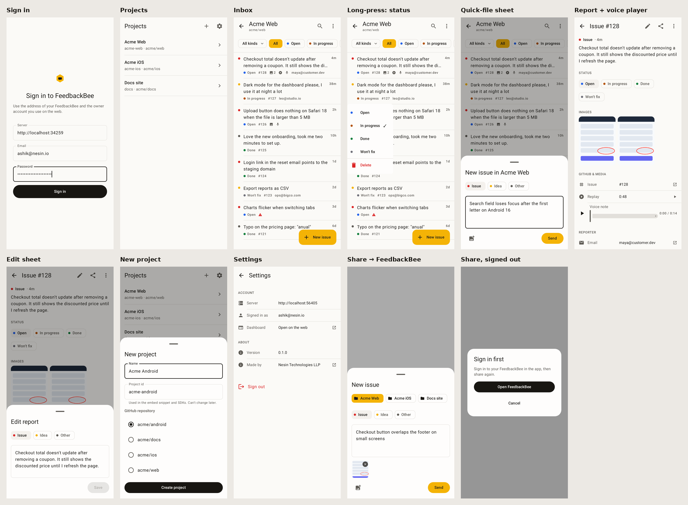

# FeedbackBee mobile apps

The owner's dashboard on iOS and Android: sign in to your FeedbackBee, pick a
project, triage its reports and file new issues from a bottom sheet. Separate
from the SDKs in `android/`, `apple/` and `react-native/`, which your users'
apps embed to send feedback; these apps are for you.

| Platform | Folder            | Stack                                                        | Min OS     |
| -------- | ----------------- | ------------------------------------------------------------ | ---------- |
| Android  | `mobile/android/` | Kotlin, Jetpack Compose, OkHttp, kotlinx.serialization, Coil | Android 10 |
| iOS      | `mobile/ios/`     | SwiftUI, Observation, URLSession; no third-party packages    | iOS 17     |

Both follow [`DESIGN.md`](DESIGN.md) (palette, screens, performance rules) and
have the same features.

<p>
  
</p>

## What they do

- **Sign in** with your server address (`bee.example.com`; `https://` is added),
  email and password. The session token is kept in the Keychain (iOS) or sealed
  with an Android Keystore key, and is sent as `Authorization: Bearer`.
- **Projects**: list, create (name, project id, a repository the GitHub App can
  reach) and delete. The last project opens on launch.
- **Inbox**: status filter (server-side), kind filter and search (on loaded
  reports), pull to refresh, infinite scroll, Sync from GitHub. Long-press a
  report for its status menu; on iOS swipe right for Done, left for Delete.
- **Report**: text, status, images (tap for full screen), GitHub issue,
  reporter, page and device context, metadata. Edit kind and text (the GitHub
  issue's title, body and label follow), share the issue link, delete.
- **Playback in the app**: voice notes play inline (play/pause, scrubber,
  time); screen recordings open full screen in the system player; session
  replays open the server's own replay page (`/replay/<key>`) in an in-app web
  view, with Open in browser. Android plays every accepted format with
  ExoPlayer (Media3); iOS uses AVPlayer for AAC/MP3/MP4 and a web view for
  WebM and Ogg, which AVFoundation can't decode.
- **Share to FeedbackBee**: share a screenshot, photos (up to 5), text or a
  link from any app. The quick-file sheet opens over that app with a project
  picker (last project first), prefilled, and closes once filed. Android: a
  translucent share activity in the app's process. iOS: a Share Extension
  (`mobile/ios/ShareExtension`) that reads the session from the App Group
  `group.io.nesin.feedbackbee` (Keychain access group, shared defaults and
  disk cache), so there is no second sign-in.
- **Quick file**: the honey **New issue** button, or the home-screen shortcut /
  quick action, opens a sheet with the note focused, kind chips and up to five
  photos (scaled to 2048 px JPEG before upload). It posts to the public submit
  endpoint as the owner, so it skips the per-IP rate limit.
- **Settings**: server, account, web dashboard, version, sign out.

## API

The apps use the dashboard API (`/api/v1/projects…`, see
[`docs/PRD.md`](../docs/PRD.md)) and the submit endpoint
([`docs/CONTRACT.md`](../docs/CONTRACT.md)). Reports are edited with
`PATCH /api/v1/projects/:id/feedback/:fid` (`status`, `kind`, `text`) and
deleted with `DELETE` on the same path; deleting leaves the GitHub issue and
media in place.

## Android

```bash
cd mobile/android
./gradlew :app:installDebug                 # on a connected device or emulator
./gradlew :app:testDebugUnitTest            # API client, formatting, every screen (Robolectric)
FEEDBACKBEE_SCREENSHOT_DIR=/tmp/shots ./gradlew :app:testDebugUnitTest   # …and save screenshots
./gradlew :app:assembleRelease              # R8-shrunk APK, signed with HUB_* env vars or the debug key
```

Plain HTTP is allowed only for `localhost`, `127.0.0.1` and the emulator's
`10.0.2.2` (`pnpm dev` / `pnpm dev:worker`).

## iOS

Open `mobile/ios/FeedbackBee.xcodeproj` in Xcode 16 or later and run the
**FeedbackBee** scheme. Two targets: the app (`FeedbackBee/`) and the Share
Extension (`ShareExtension/`); views both use live in `Shared/`. Models, the
API client, session storage, the disk cache and the observable stores live in
the local `Core` package, which builds and tests anywhere Swift runs:

```bash
cd mobile/ios/Core && swift test              # macOS or Linux
cd mobile/ios && ./screenshots.sh /tmp/shots  # simulator screenshots, light and dark
```

Debug builds accept `-demoScreen <signIn|projects|inbox|compose|report|edit|newProject|settings|share>`
to open one screen against a built-in fake server (`FeedbackBee/DemoMode.swift`);
release builds don't contain it. To run on a device, set your team for both
targets under Signing & Capabilities; Xcode registers the App Group with
automatic signing.

## Performance

- First paint never waits for the network: the project list and each inbox's
  first page are cached on disk, shown at once, then refreshed.
- JSON is decoded off the main thread (OkHttp's threads; URLSession's
  executors), lists are lazy with stable ids.
- Media at `/f/<key>` is immutable: cached on disk for good and decoded at the
  size it's shown (Coil; ImageIO thumbnails on iOS), full size only in the
  viewer.
- Status changes and deletes are optimistic and roll back on failure.

## CI

`.github/workflows/mobile-apps.yml` runs on changes under `mobile/`: Android
unit and screen tests, release build and lint on Ubuntu; iOS Core tests,
simulator screenshots and a release build on macOS. Both upload their
screenshots as artifacts.
