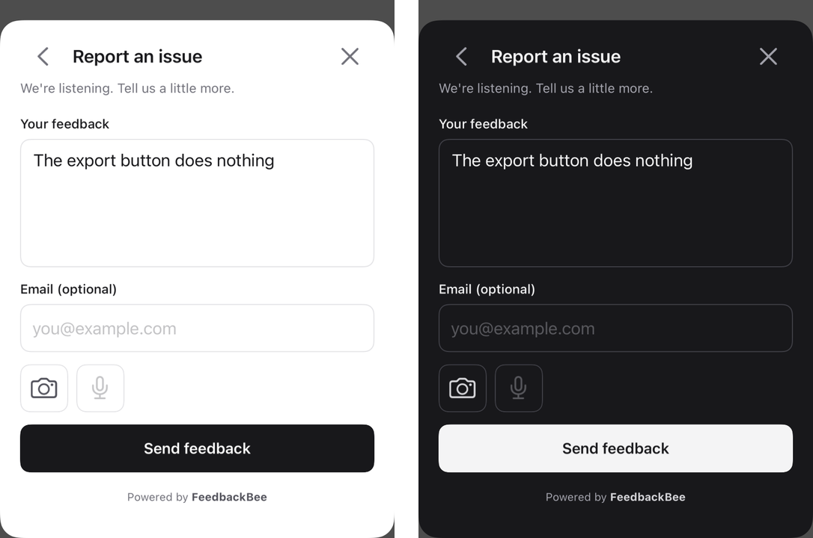
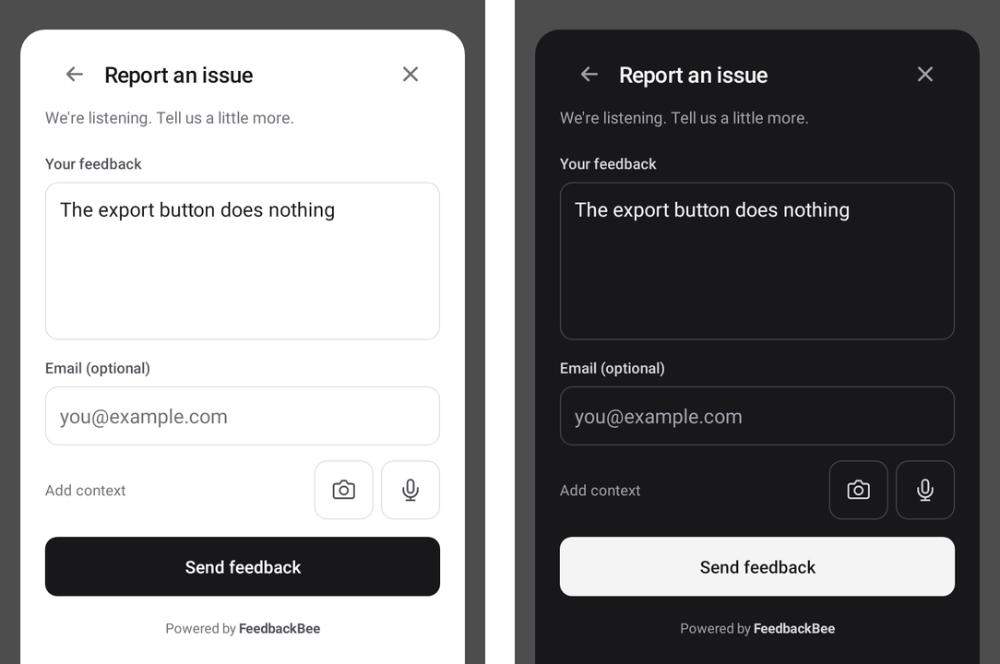

# FeedbackBee for React Native

Shake-to-feedback with annotated screenshots and voice notes, filed as GitHub issues by your FeedbackBee Worker.

This package is a thin TurboModule over the native [iOS](../apple/README.md) and [Android](../android/README.md) SDKs.
The sheet, screenshot, annotation, recording and upload are all native, so:

- **No JS work while the sheet is open.** Nothing renders in React, nothing crosses the bridge per keystroke or stroke.
- **Five calls, all JSI.** `init`, `open`, `identify`, `setContext` and `reset` are direct TurboModule calls with
  scalar arguments; only `init` is synchronous (it validates the config so mistakes throw in JS).
- **Zero cost at startup.** Importing the package does nothing: the native module is looked up on the first call, its
  iOS setup skips the main queue, and there are no event listeners. Shake detection uses the platform's own signal
  (iOS's shake gesture; on Android, a batched accelerometer listener only while an activity is resumed).
- **Large attachments never touch JS.** Screenshots and voice notes go from the native capture to the HTTP stream.

Requires React Native 0.76+ with the New Architecture (the default since 0.76, and the only one since 0.82),
iOS 15.1+, and Android minSdk 26.

## Install

The package is not on npm yet. Build a tarball from a checkout (this vendors the native SDK sources into it) and
install that:

```bash
cd feedbackbee/react-native && pnpm install --ignore-workspace && pnpm pack
cd your-app && npm install ../feedbackbee/react-native/react-native-feedbackbee-0.1.0.tgz
cd ios && pod install
```

Then:

- **iOS:** add `NSMicrophoneUsageDescription` to `Info.plist` to enable voice notes (without it the mic is hidden).
- **Android:** set `minSdkVersion = 26` in `android/build.gradle` if it is lower. `MainActivity` (a `ReactActivity`)
  already satisfies the SDK's `FragmentActivity` requirement. Internet and microphone permissions merge automatically.
- **Expo:** use a development build (`npx expo prebuild`); Expo Go has no native module, and the API logs one warning
  and does nothing there.

## Use

```ts
import FeedbackBee from "react-native-feedbackbee";

// Once, at startup (outside a component, or in a top-level effect).
FeedbackBee.init({ projectId: "myapp", endpoint: "https://bee.example.dev" });

FeedbackBee.open(); // the picker, like a shake
FeedbackBee.open({ kind: "issue", lockKind: true }); // a "Report a problem" button
FeedbackBee.identify({ email: "jane@acme.com", name: "Jane", id: "u_123" }); // dashboard-only
FeedbackBee.setContext({ plan: "pro", build: 4211, beta: true }); // dashboard-only; null removes a key
FeedbackBee.reset(); // on logout
```

| Option      | Default  | Notes                                                                                                   |
| ----------- | -------- | ------------------------------------------------------------------------------------------------------- |
| `projectId` | required | From your dashboard. Blank throws.                                                                      |
| `endpoint`  | required | Your FeedbackBee website or Worker base URL, including `https://`. Bad URLs throw.                      |
| `shake`     | `true`   | In development, the React Native dev menu also opens on shake: `shake: !__DEV__` avoids both appearing. |

`kind` is `"issue"`, `"feature_request"` or `"other"`. Reports carry `os_name` `ios` or `android` with the native
device fields; `identify` / `setContext` data reaches your dashboard only, never the GitHub issue.

The package ships TypeScript types: `InitOptions`, `OpenOptions`, `Reporter`, `ContextValue` and `FeedbackKind`.

## What the user sees

The native sheet on each platform: the same three screens (pick a type, write the note with optional screenshot
markup and voice note, sent). The screens are described in the [Apple](../apple/README.md#what-the-user-sees) and
[Android](../android/README.md#what-the-user-sees) READMEs.

| iOS                                                                                                    | Android                                                                                                        |
| ------------------------------------------------------------------------------------------------------ | -------------------------------------------------------------------------------------------------------------- |
|  |  |

## Light and dark mode

The sheet follows your app's color scheme on both platforms, with nothing to configure:

- **System setting**: followed by default.
- **`Appearance.setColorScheme("light" | "dark")`**: followed. On iOS the sheet's window copies the style React Native
  sets on your app's window. On Android it is a night-mode change that the sheet picks up from the activity theme.
- **Forced in native config**: `UIUserInterfaceStyle` in `Info.plist` on iOS, or a non-DayNight theme in
  `styles.xml` on Android. The sheet matches it.
- **Switching while the sheet is open**: handled on both. React Native's `MainActivity` handles `uiMode` itself, so
  Android doesn't recreate it; the SDK rebuilds the sheet for the new scheme and keeps the draft.

The light and dark palettes, shared with the web widget, are listed in the
[Apple README](../apple/README.md#light-and-dark-mode) and the [Android README](../android/README.md#light-and-dark-mode).

## Permissions and privacy

- **Network**: Android merges `INTERNET` automatically; iOS needs nothing.
- **Microphone, for voice notes**: on iOS, add `NSMicrophoneUsageDescription` to `Info.plist`; without it the mic button
  is hidden. On Android, `RECORD_AUDIO` is merged automatically and requested only when the user taps the mic.
- **Screenshots**: read only your app's own window, only after the user taps the camera. No photo-library, camera or
  screen-recording permission is involved.
- Nothing leaves the device until the user presses **Send**.

## Troubleshooting

| Symptom                                                          | Fix                                                                                                                              |
| ---------------------------------------------------------------- | -------------------------------------------------------------------------------------------------------------------------------- |
| "the native module is not linked" warning, calls do nothing      | Rebuild the native app after installing (`pod install`, then build). Expo Go can't load native modules: use a development build. |
| `init` throws `endpoint must be a valid http:// or https:// URL` | Pass the base URL of your FeedbackBee deployment, like `https://bee.example.dev`, not `/api/v1/feedback`.                        |
| Shake opens the React Native dev menu too                        | Expected in development; pass `shake: !__DEV__`.                                                                                 |
| Android build fails on `minSdkVersion`                           | Set `minSdkVersion = 26` in `android/build.gradle`.                                                                              |
| `vendor/ios is missing` / `vendor/android is missing`            | Install the tarball from `pnpm pack`, not the raw folder, or run `pnpm vendor` in `react-native/`.                               |
| Nothing opens on Android                                         | The foreground activity must be a `FragmentActivity`; `ReactActivity` is one. Check Logcat for the `FeedbackBee` tag.            |

## Develop

```bash
pnpm install --ignore-workspace
pnpm typecheck
pnpm codegen   # runs React Native codegen on src/NativeFeedbackBee.ts into build/codegen
pnpm vendor    # copies ../ios and ../android SDK sources into vendor/ (pnpm pack does this too)
```

`src/NativeFeedbackBee.ts` is the codegen spec; `ios/FeedbackBeeModule.mm` and
`android/.../FeedbackBeeModule.kt` implement it. A change to the spec changes both.
